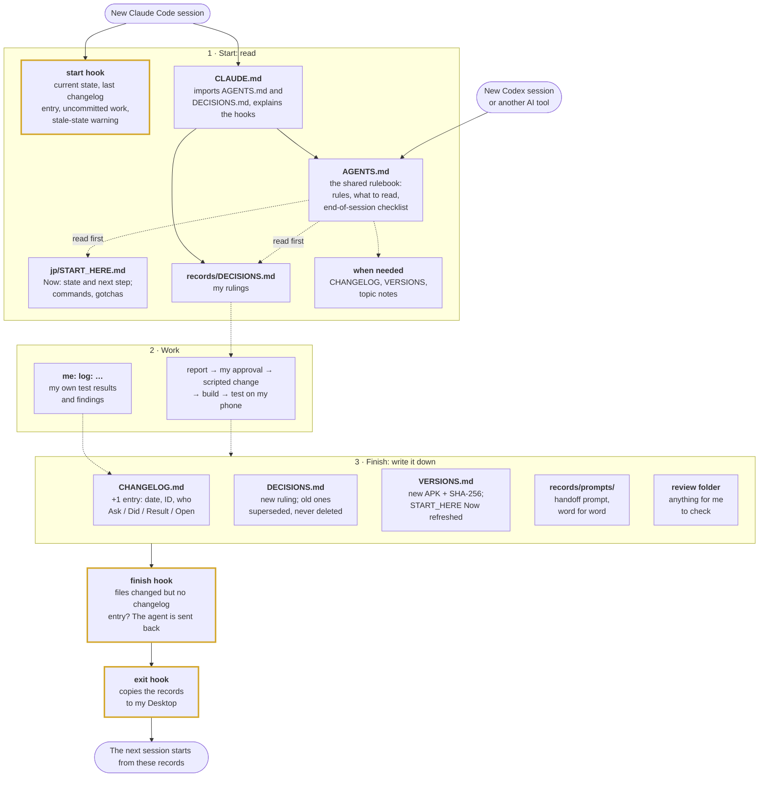

# AI workflow

Engineering notes on directing AI coding agents through a reverse-engineering project, and checking
their work before anything shipped.

---

## Summary

*Zombie Cafe* is a 2010 Capcom Android game whose source code was never released. I maintain a
revival of it. Since June 2026 I've worked with AI coding agents (Claude Code and Codex) to assist
in development. The agents did most of the hands-on work: reading disassembled ARM code, and writing
the patches, scripts and reports. My job was to set the goals and rules, question their conclusions,
test every build on a real phone, and decide what shipped.

What that produced:

- **Three English releases** (June–July 2026) the game running on modern Android, a full economy
  rebalance, and a repaired soundtrack. ~3200 downloads on github.
- **A Japanese release (1.7.0) in English.** Fully translated, three memory bugs patched, and running
  on 32-bit capable androids. Future updates including a rebalance of the economy still planned.

The commits in this repository are under my name. This page is where I set out what the AI did.

---

## How I work with the agents

```
   Goal or spec (me)
        |
        v
   Agent investigates  ->  written report, no changes made
        |
        v
   I review it (sometimes a second AI reviews it too)
        |
        +-- not convinced -> more evidence, or a different approach --+
        |                                                             |
        v approved                                                    |
   Scripted change: checks the value it expects to replace,           |
   refuses half-applied patches, keeps a rollback                     |
        |                                                             |
        v                                                             |
   Build -> test on my phone (with a control build when it matters) --+
        |
        v
   Decision recorded -> release
```

The rules every agent session reads first (`AGENTS.md` and a register of my decisions):

- Proposals are report-only until I approve them; balance changes only enter the build as rows I've
  signed off.
- Every change is scripted and states the value it expects to find, so a stale or repeated change
  aborts the build instead of silently corrupting data, and every change can be rolled back.
- The original game files are identified by checksum and never modified; each new build is compared
  file by file against them.
- Only my phone (a Galaxy A54) counts as a test. The emulator runs Android 9, which can't detect the
  memory bugs this game has.
- Decisions, builds and key prompts are written into `records/`, so the next session (or a different
  tool) starts from facts instead of re-deriving them.

### How the repo keeps its memory

Every agent session starts with a blank memory, and I use more than one tool, so anything that
isn't written down gets re-derived (or gotten wrong) next time. Early on I relied on each tool's own
notes. Since October 2026 the project's memory lives in the repo itself, where any AI or person can
read the same thing.

I give each objective its own fresh session instead of running one long chat. A long chat re-reads
the whole conversation on every message, so each reply costs more than the last, and when it fills
up it gets summarised automatically, and I don't choose what the summary keeps. A fresh session is
cheap to start as long as the repo carries the context: it reads four files (about 28 KB of text)
and it's up to speed, without me catching it up. The exception is one tight investigation, like a
crash hunt, where the working notes are too much to write down halfway; that stays in one session.

Instructions in a file are only suggestions: an agent can skip a step or forget the checklist at the
end. So the steps that matter most are run by Claude Code itself, as *hooks*: small scripts that fire
at fixed points in every session, whatever the agent decides.



*Solid arrows happen automatically. Dashed arrows are steps the agent takes because the files tell it
to. Gold boxes are hooks, which Claude Code runs itself, so the agent can't skip them. Codex gets the
same rulebook, but reads my rulings by instruction and has no hooks.*

| File | What goes in it |
|---|---|
| `AGENTS.md` | The one rulebook for every AI tool. Codex reads it directly and Claude Code loads it through `CLAUDE.md`, so they all work from the same rules: what to read first; report first; balance changes only through my approved override rows; never change a playable chef without asking; never modify the original APKs or the decoded base data; reach the phone only through Windows adb; don't commit, push or publish anything unless I ask; no AI attribution lines in commits; flag important caveats before acting. It ends with the `log:` rule and the end-of-session checklist (below). |
| `CLAUDE.md` | Loaded automatically by Claude Code at the start of every session. Its `@AGENTS.md` and `@records/DECISIONS.md` lines make Claude Code paste both files in before the agent reads anything, so the rules and my rulings are always loaded rather than left to the agent to look up. It also explains the hooks. |
| `.claude/settings.json` + `.claude/hooks/` | The hooks: at session start (and after a summary or `/clear`) a script adds the current state to the agent's context and warns if `START_HERE` looks out of date; before the agent finishes a reply, a script checks whether files changed without a changelog entry and sends it back once if so; at session end, a script copies the records to my Desktop. |
| `jp/START_HERE.md` | A dated **Now** block (what's released, what's in progress, the next step, what's waiting on me) and roadmap progress, then reference: repo map, build/install/test commands, how balance changes must be made, the data fields that matter, and "gotchas learned the hard way". It links to the records below instead of repeating them, so each fact lives in one place. |
| `records/DECISIONS.md` | My rulings, numbered (D-01 to D-21): date, ruling, one-line reason. A changed ruling supersedes the old one, which is never deleted. Examples: D-05 "never change a playable chef without asking"; D-09 "$2,000 per Toxin"; D-16 "describe compatibility as 32-bit app support, not by Android version". |
| `records/CHANGELOG.md` | One short entry per milestone: date, ID, title and who did it (me, Claude Code, Codex, ChatGPT), then *Ask* (my request, often quoted), *Did*, *Result* (versions, hashes, test numbers) and *Open*. |
| `records/VERSIONS.md` | Every APK built: what changed, its SHA-256, and whether it actually ran on the phone. Debug builds are marked "never distribute". |
| `records/prompts/` | Prompts that hand work to a new session, saved word for word. |
| `records/EN_ARCHIVE.md` | A one-page summary of the paused English work, so it doesn't have to be re-read. |

The end-of-session checklist in `AGENTS.md` makes every session that changes something leave a
changelog entry, record any new ruling, register any new APK with its hash, refresh the Now block,
save any handoff prompt and put anything for me to review in a review folder. My own findings go in
the same way: when I write `log:` followed by a play-test result or something I noticed, the agent
records it as an entry from me.

---

What was actually changed in the game, and how each problem was found, is in the
[technical write-up](TECHNICAL_WRITEUP.md).
